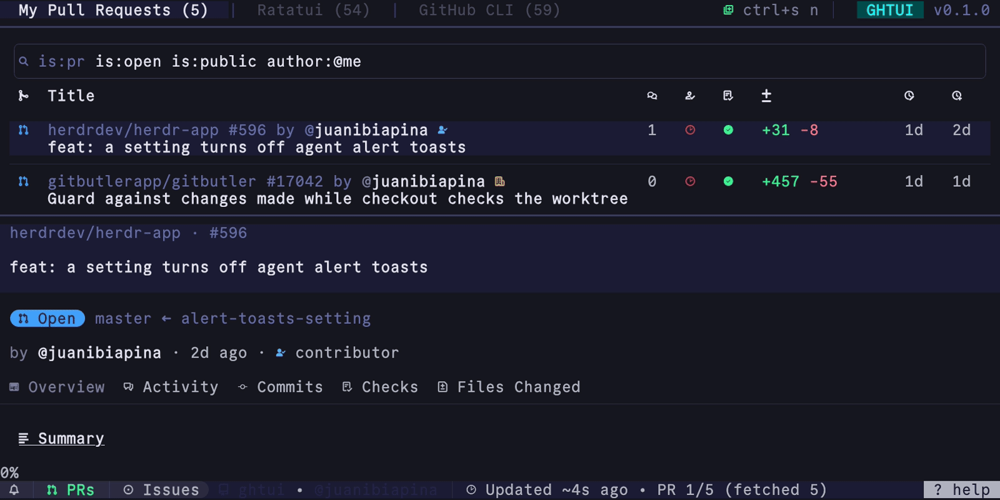

<br />
<p align="center">
  <picture>
    <source media="(prefers-color-scheme: dark)" srcset="./docs/public/logo.png">
    
  </picture>
</p>

<p align="center">
  A rich terminal UI for GitHub that doesn't break your flow.
  <br />
  <br />
  <a href="https://www.jetify.com/docs/devbox" alt="Built with Devbox"></a>
</p>

<br />



## 🌟 Features

- User-defined, per-repo, PRs & issues sections
- Overridable vim-style keyboard hotkeys
- Custom actions to perform your specific workflow needs
- Everything you can do on GitHub - diff, comment, checkout, push, update etc.
- Control every setting with a YAML config file

If you like quickly navigating with your keyboard, seeing the PRs and issues you need and you <strong>love the terminal</strong> - <code>DASH</code> is for you! 🫵🏽

## 📦 Install

```sh
git clone https://github.com/juanibiapina/gh-dash
cd gh-dash
go build -o gh-dash .
gh extension install .
```

To update, run `git pull` and `go build -o gh-dash .` again.

## 📃 Docs

The docs live in [docs/src/content/docs](./docs/src/content/docs).

## 🙏 Contributing

See [CONTRIBUTING.md](./CONTRIBUTING.md).

## 🛞 Under the hood

`DASH` uses:

- [bubbletea](https://github.com/charmbracelet/bubbletea) for the TUI
- [lipgloss](https://github.com/charmbracelet/lipgloss) for the styling
- [glamour](https://github.com/charmbracelet/glamour) for rendering markdown
- [vhs](https://github.com/charmbracelet/vhs) for generating the GIF
- [cobra](https://github.com/spf13/cobra) for the CLI
- [gh](https://github.com/cli/cli) for the GitHub functionality
- [delta](https://github.com/dandavison/delta) for viewing PR diffs

## Credits

Forked from [dlvhdr/gh-dash](https://github.com/dlvhdr/gh-dash) by Dolev Hadar, MIT licensed.
