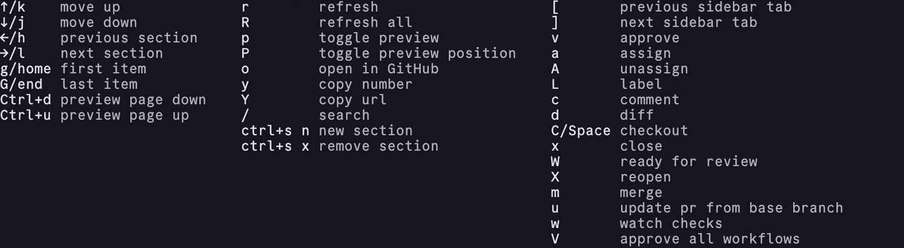
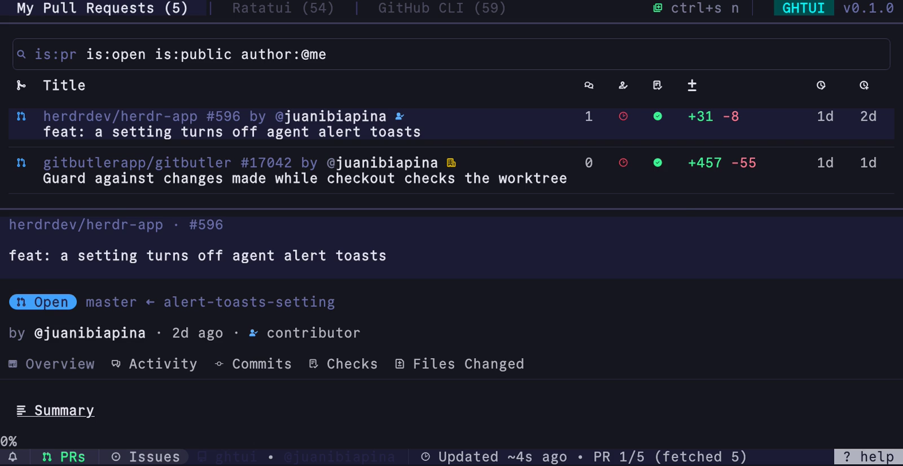

export const base = import.meta.env.BASE_URL.replace(/\/$/, "");

```sh frame="none"
brew install juanibiapina/taps/ghtui
```

<video autoplay loop muted playsinline>
  <source src={`${base}/overview.webm`} type="video/webm" />
  <source src={`${base}/overview.mp4`} type="video/mp4" />
</video>

## Custom filters

Define sections with any GitHub search filter.

```yaml
prSections:
  - title: My Pull Requests
    filters: is:open author:@me
  - title: Needs My Review
    filters: is:open review-requested:@me
issuesSections:
  - title: Ghostty
    filters: is:open ghostty-org/ghostty
  - title: Neovim
    filters: is:open neovim/neovim
```

<video autoplay loop muted playsinline>
  <source src={`${base}/sections.webm`} type="video/webm" />
  <source src={`${base}/sections.mp4`} type="video/mp4" />
</video>

## Vim keybindings

Move and act without leaving the keyboard.

- <kbd>h</kbd> <kbd>j</kbd> <kbd>k</kbd> <kbd>l</kbd> move between rows and sections
- <kbd>ctrl+d</kbd> <kbd>ctrl+u</kbd> scroll the preview
- <kbd>o</kbd> opens the item in the browser
- <kbd>y</kbd> <kbd>Y</kbd> copy the number or URL
- <kbd>?</kbd> shows every key



## Custom commands

Bind keys to your own shell commands, with the PR or repo filled in.

```yaml
keybindings:
  prs:
    - key: g
      name: lazygit
      command: lazygit
    - key: C
      name: code review
      command: >
        tmux new-window -c {{.RepoPath}}
        'nvim -c ":silent Octo pr edit {{.PrNumber}}"'
```

<video autoplay loop muted playsinline>
  <source src={`${base}/custom-commands.webm`} type="video/webm" />
  <source src={`${base}/custom-commands.mp4`} type="video/mp4" />
</video>

## Themes

Set every color to match your terminal.

```yaml
theme:
  colors:
    text:
      primary: "#ffffff"
      secondary: "#c6c6c6"
```


